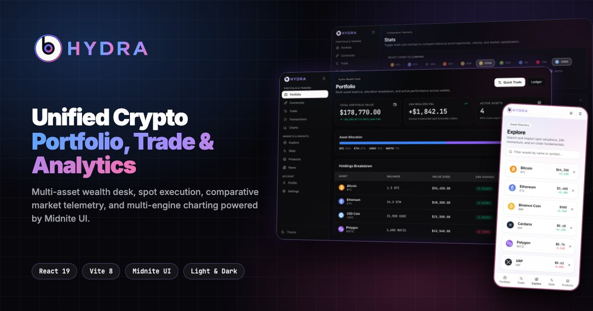

# Hydra



A unified crypto portfolio, market explorer, multi-asset trading desk, live statistics, news, and multi-engine chart analytics application powered by **React 19**, **Vite 8**, **TypeScript**, and **Midnite UI**.

[](https://depshield.github.io)

## Routes & Features

### Portfolio & Trading
- `/` & `/portfolio` — Multi-asset wealth desk with allocation breakdown, 24h P&L, and holdings table
- `/currencies` — Currency directory and asset converter
- `/trade` — Spot & bundle trading execution desk
- `/transactions` — Execution ledger with filtering and export
- `/charts` — Multi-engine interactive chart analytics (Recharts, Chart.js, Victory)

### Markets & Insights
- `/explore` & `/explore/:id` — Crypto asset directory with live search, detail telemetry, and candlestick/line charts
- `/stats` — Comparative multi-coin Highcharts telemetry (price, volume, market cap)
- `/products` — Financial products and curated market offerings
- `/news` — Market news feed

### Account & Preferences
- `/profile` — Account identity & profile overview
- `/settings` — Theme (`light`, `dark`, `system`, `time`), language (`i18next`), and preferences
- `/login` — Authentication view

## Development

```sh
corepack yarn install
corepack yarn dev        # Vite dev server
corepack yarn typecheck  # TypeScript check
corepack yarn test --run # Vitest unit & render tests
corepack yarn build      # Production build
```

## CI

[CI pipeline](https://github.com/bilo-io/hydra/actions/workflows/CI.yml)

Other Services:

- [Codecov](https://app.codecov.io/gh/bilo-io/hydra)
- [Codacy](https://app.codacy.com/gh/bilo-io/hydra/dashboard)
- [Chromatic](https://www.chromatic.com/builds?appId=60e4baad0268f0003b338149&branch=feature%2Fci-testing)
- [Snyk (`package.json` security)](https://app.snyk.io/org/bilo-io/project/5a81d38a-9470-4a4d-8534-c7b091589784)
- [Vercel Deployment](https://hydra.vercel.app/)

## APIs

- [Top 5 CryptoCurrency APIs (LunarCrush)](https://towardsdatascience.com/top-5-best-cryptocurrency-apis-for-developers-32475d2eb749)
- [Trade: Binance](https://www.binance.com/en/support/faq/c-6)
- [Historic: CoinGecko](https://www.coingecko.com/api/documentations/v3#/)

## Resources

- [Top 100 Cryptocurrency List](https://coinnws.com/cryptocurrency-list/)
- [Whitepaper Database](https://coinnws.com/whitepaper-database/)
